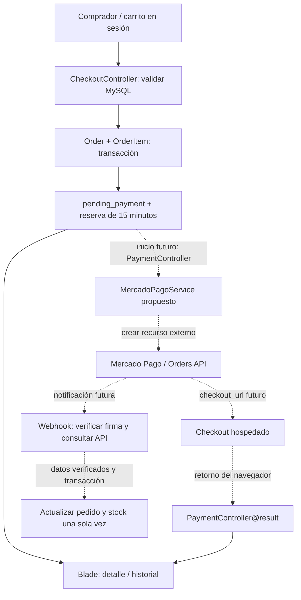

# Etapa 6 — Preparación de Mercado Pago hasta Clase 7

## Alcance y materiales

Se revisaron la presentación original de Clase 7 y su extracción en `texto/Clase_7.md`, en particular las diapositivas 12, 17, 20 y 25 a 33 (numeración de la extracción). La clase enseña arquitectura, configuración y diseño del circuito. No contiene una implementación terminada de pagos.

| Momento | Contenido |
| --- | --- |
| Clase 7 / esta etapa | Diferenciar pedido local y recurso externo; preparar credenciales; diseñar responsabilidades, rutas, estados y confirmación segura. |
| Clase 8, según el anuncio de Clase 7 | Llamar a Orders API con credenciales de prueba, obtener `checkout_url` y simular compras. |
| Después, según la misma presentación | Implementar webhooks y validar la confirmación del proveedor. No se atribuye este desarrollo completo a Clase 8 sin su material. |

No se agregó SDK, cliente HTTP de pagos, generación de enlaces, aprobación simulada, formulario de tarjetas ni cambios visuales. Completar credenciales no habilita ninguna operación. Las nuevas rutas carecen deliberadamente de implementación de pagos.

## Lo que ya existe y se conserva

- `CheckoutController@create`: revisa el carrito con precios de MySQL.
- `CheckoutController@store`: revalida cantidades, productos y categorías activos; bloquea filas; guarda pedido y detalles dentro de una transacción con reintentos.
- `Order` y `OrderItem`: pedido y fotografía histórica de nombre, cantidad y precio.
- `checkout_token` único: evita duplicar el pedido local por reenvío.
- `OrderController`: consulta y cancelación restringidas al dueño mediante su relación `orders()`; el middleware excluye administradores.
- `Plato@availableStock`: stock físico menos reservas pendientes vigentes.
- `orders:expire`: persiste vencimientos; la disponibilidad ya ignora reservas vencidas aunque el programador esté detenido.

No se modificaron estas reglas ni el esquema de MySQL en esta etapa.

## Configuración preparada

`config/services.php` contiene:

```php
'mercadopago' => [
    'access_token' => env('MP_ACCESS_TOKEN'),
    'public_key' => env('MP_PUBLIC_KEY'),
],
```

En `.env.example` y, si faltaban, en el `.env` local se agregaron variables vacías:

```dotenv
MP_ACCESS_TOKEN=
MP_PUBLIC_KEY=
```

No se copiaron valores de credenciales. En el futuro, el backend usará `config('services.mercadopago.access_token')`; `env()` queda limitado a configuración. En esta etapa ninguna ruta necesita leer esas claves.

El Access Token es privado. No ponerlo en Blade, JavaScript, variables `VITE_*`, logs, capturas, trabajos de facultad o chats. La Public Key tiene otro rol, pero tampoco se expone en esta preparación porque no se necesita. `.env` ya figura en `.gitignore`; no compartirlo aunque esta carpeta todavía no tenga repositorio Git.

Después de editar localmente `.env`, ejecutar:

```powershell
php artisan config:clear
```

No usar `config:show services` ni volcar la configuración para verificar claves: mostraría secretos. Basta conservarlas en el archivo privado; no hace falta enviarlas al asistente.

## Configuración manual en Mercado Pago

1. Abrir [Mercado Pago Developers](https://www.mercadopago.com.ar/developers/es/docs/checkout-pro-orders/create-application) e ingresar personalmente.
2. En **Tus integraciones / Integraciones**, crear una aplicación llamada **Menú a tu Medida — Facultad**, o seleccionar la existente.
3. Elegir **Checkout Pro**, vía **Orders API** cuando el panel lo ofrezca. No cambiar a Checkout API o Bricks.
4. Abrir la aplicación y seleccionar **Prueba**. En **Credenciales**, ubicar Public Key y Access Token.
5. Copiar las claves de Prueba únicamente al `.env` local; limpiar la caché de configuración. No activar producción.

Las credenciales de prueba se generan con la aplicación. El prefijo del token por sí solo no identifica el entorno: verificar el selector **Prueba**. Los nombres del panel pueden variar. [Fuente oficial: aplicación y credenciales](https://www.mercadopago.com.ar/developers/es/docs/checkout-pro-orders/create-application).

La diapositiva 21 explica comprador y vendedor de prueba separados, del mismo país. Si el docente pide ese ejercicio, localizar **Cuentas de prueba**, crear o identificar una cuenta compradora distinta de la vendedora y conservar sus datos en privado; no crear otra aplicación sin que el ejercicio lo requiera. Si el panel no permite continuar, registrar la observación de la demo docente, como admite la diapositiva 17.

**Diferencia con la documentación actual:** Checkout Pro con Orders permite probar sin cuenta compradora, en incógnito y sin iniciar sesión en Mercado Pago. Esto no elimina el login de comprador de nuestra tienda. El uso de tarjetas de prueba y la compra simulada se posponen a la siguiente etapa. [Fuente oficial: pruebas de Checkout Pro con Orders](https://www.mercadopago.com.ar/developers/es/docs/checkout-pro-orders/integration-test-introduction).

No configurar todavía una URL de webhook en el panel: la ruta local no es un receptor operativo. Una futura notificación requerirá URL pública HTTPS y verificación del proveedor. No se publica el proyecto ni se abre un túnel en esta etapa.

### Checklist que debe completar la estudiante

- [ ] Aplicación creada o existente identificada.
- [ ] Producto Checkout Pro / Orders reconocido.
- [ ] Selector en Prueba y credenciales ubicadas.
- [ ] Credenciales guardadas solo localmente, o pendientes deliberadamente.
- [ ] Ejercicio de cuentas de prueba realizado, o diferencia actual comentada con el docente.
- [ ] Si no se pudo acceder, demo docente observada y pasos registrados.
- [ ] Sin producción, cobros ni compras simuladas en esta etapa.

Estas tareas del panel no fueron ejecutadas por el asistente.

## Rutas y controladores preparados

| Ruta | Nombre | Responsable | Comportamiento actual |
| --- | --- | --- | --- |
| GET /checkout | checkout.create | CheckoutController@create | Revisión local existente. |
| POST /checkout | checkout.store | CheckoutController@store | Crea pedido pendiente local, sin pasarela. |
| POST /pedidos/{order}/pago | payments.store | PaymentController@store | Comprueba que el pedido pertenece al comprador y devuelve HTTP 501: no implementado. |
| GET /pedidos/{order}/pago/resultado | payments.result | PaymentController@result | Comprueba pertenencia y redirige al detalle persistido. No interpreta parámetros de pago. |
| POST /mercadopago/webhook | mercadopago.webhook | MercadoPagoWebhookController | Punto reservado; devuelve 501 al llegar al controlador. CSRF sigue activo: una petición externa sin token recibe 419. |

La propuesta de Clase 7 usa `start()` y `result()` en CheckoutController. Aquí se conserva `POST /checkout` de la Etapa 5 y se separa el inicio futuro del pago para reutilizar un pedido existente, evitando crear otro pedido al reintentar. Los nombres de rutas son internos, no requisitos de Mercado Pago.

No se agregaron enlaces a estas rutas en la tienda. Las rutas de comprador usan EnsureBuyer. Un pedido ajeno devuelve 404. El retorno puede recibir `status=approved` o un supuesto `payment_id`: se ignoran y el pedido permanece como está en MySQL.

El webhook no exige login de comprador, pero **todavía no acepta notificaciones**. No se quitó CSRF ni se implementó una firma ficticia. En una etapa posterior se abrirá al proveedor junto con validación de autenticidad, consulta del estado y protección contra repetidos. No devolver 200 como si ya se hubiera procesado un evento.

El futuro **MercadoPagoService** será responsable de la comunicación externa desde el backend. Se representa en el diseño, pero no se creó una clase vacía ni un cliente que sugiera una integración funcional.

## Diagrama de arquitectura

Las líneas continuas representan el flujo local existente; las punteadas representan trabajo futuro.



## Flujo completo diseñado

1. El comprador arma el carrito. Eso no reserva stock.
2. Laravel autentica, revisa productos, cantidades, categorías y precios de MySQL.
3. La confirmación crea `orders` y `order_items`, guarda el total en centavos y reserva disponibilidad por 15 minutos. El pedido queda `pending_payment`.
4. **Futuro:** iniciar pago sobre ese pedido; comprobar propietario, vigencia y ausencia de aprobación previa. No volver a crear el pedido.
5. **Futuro:** el servicio enviará el total y los ítems históricos; relacionará `pedido-{id}` como `external_reference`. Guardará el identificador externo en `mp_order_id`.
6. **Clase 8:** recibir `checkout_url` y redirigir al checkout hospedado para pruebas. Crear el recurso externo no prueba que se pagó.
7. El navegador vuelve al detalle. Ese retorno solo informa el estado local; nunca aprueba una compra.
8. **Etapa posterior:** una notificación autenticada motivará la consulta del estado al proveedor. Se contrastarán referencia, identificador externo, importe, moneda y cuenta receptora.
9. Solo una confirmación verificada permitirá actualizar el pedido y consumir stock de forma atómica e idempotente. Los eventos repetidos no deben consumir stock dos veces.

Si la API falla, el pedido sigue sin pagar y la reserva conserva su vencimiento original. El reintento externo requerirá una clave de idempotencia propia: `checkout_token` protege hoy la creación local, pero por sí solo no deduplica solicitudes al proveedor. Una llamada externa no debe mantener bloqueada la transacción local durante una espera de red.

## Campos existentes y relación futura

| Campo | Uso |
| --- | --- |
| orders.id / user_id | Identifica pedido local y comprador. |
| orders.checkout_token | Idempotencia local. |
| orders.total_cents / currency | Total entero en centavos y moneda ARS. |
| orders.status | Estado comercial interno. |
| orders.reserved_until | Vencimiento de disponibilidad reservada. |
| orders.mp_order_id | Identificador externo futuro; hoy permanece sin configurar por estas rutas. |
| order_items.plato_id / nombre | Relación y nombre histórico. |
| order_items.quantity / unit_cents | Cantidad y precio histórico; subtotal = cantidad por precio. |

Ejemplo didáctico: dos platos a $1.005,25 generan `unit_cents=100525` y `total_cents=201050`, equivalente a $2.010,50 ARS. En el envío futuro, el formato decimal se construirá desde esos enteros; no desde un total del navegador. Los nombres exactos y estados de la API se verificarán al implementarla: la Clase 7 presenta un ejemplo conceptual.

## Estados y reservas

| Estado local | Hoy | Diseño para la integración futura |
| --- | --- | --- |
| pending_payment | Nace al confirmar; reserva lógica vigente por 15 minutos. | Una respuesta pendiente conserva el estado; no prorrogar stock indefinidamente. |
| cancelled | El dueño cancela un pedido pendiente vigente y libera disponibilidad. | Coordinar cancelación externa antes de habilitar pagos; cancelación local no significa que el proveedor ya canceló una operación. |
| expired | Al vencer, la reserva deja de contar; el comando persiste el estado. | Impedir nuevos inicios; coordinar vencimiento externo y conciliación de eventos tardíos. |
| rejected | Estado previsto; esta etapa no lo asigna mediante pagos. | Rechazo verificado libera reserva. Reintento exige validar disponibilidad y un nuevo intento seguro. |
| paid | Estado previsto; ninguna ruta nueva lo asigna. | Aprobación verificada, reserva vigente y transacción para consumir stock una vez. |

La reserva es lógica: `stock disponible = stock físico - cantidades pendientes con reserved_until futuro`. No se resta stock físico al registrar un pedido sin pagar.

**Punto pendiente antes de habilitar pagos:** una aprobación puede llegar después del vencimiento o de una cancelación. No se puede asumir que queda stock ni descartar un cobro confirmado. Habrá que conciliar el caso, revalidar existencias y definir revisión/reembolso si no se puede cumplir, con registro explícito. Esa implementación y sus posibles campos/estados adicionales quedan fuera de Clase 7.

El sistema actual no debe conectarse a pagos simplemente reemplazando el 501: todavía faltan idempotencia externa, coordinación de cancelaciones/vencimientos, verificación y pruebas de notificaciones repetidas o fuera de orden.

## Guion para defensa oral

> Mi tienda valida el carrito con datos de MySQL y crea un pedido local pendiente junto con sus detalles históricos. La operación usa una transacción, bloqueos y una clave única para evitar duplicados. Mientras está pendiente reserva disponibilidad durante quince minutos, sin descontar el stock físico.
>
> En la Clase 7 preparé las variables de entorno y separé las responsabilidades del inicio, del retorno y de las notificaciones. El token privado queda en el servidor. Las rutas de pago están deshabilitadas y no hacen solicitudes externas.
>
> En la próxima etapa un servicio enviará el pedido a Mercado Pago y recibirá el enlace del checkout. El pedido local y el recurso externo son distintos y se vincularán por una referencia.
>
> Volver a una página de éxito no demuestra que se pagó. La confirmación deberá verificarse desde el servidor antes de cambiar el estado o consumir stock. Hoy no cobro ni simulo una aprobación.

Preguntas breves:

- **¿Por qué Checkout Pro?** Aloja el formulario de pago en el proveedor; nuestra tienda conserva catálogo, pedidos y stock.
- **¿Qué es checkout_url?** El enlace futuro al checkout externo. Esta etapa no lo genera.
- **¿Qué hace el webhook?** Avisará de un cambio; Laravel verificará su autenticidad y consultará el estado.
- **¿Por qué no usar el precio del navegador?** Puede alterarse; el precio de la compra sale de MySQL y queda registrado en sus detalles.
- **¿Agregar credenciales activa pagos?** No. El inicio y el webhook permanecen sin implementar.

## Comprobación local

```powershell
php artisan test --compact tests/Feature/MercadoPagoPreparationTest.php tests/Feature/CheckoutTest.php
php artisan test --compact
php artisan route:list --name=payments
php artisan route:list --name=mercadopago
```

Las pruebas de preparación usan bases de prueba y valores ficticios: comprueban ausencia de solicitudes HTTP, preservación de pedidos y reservas, aislamiento entre compradores, CSRF y rechazo de supuestos estados aprobados. No representan confirmaciones del proveedor.

La suite habitual omite las dos pruebas de concurrencia exclusivas de MySQL; esas requieren un servidor aislado y una base cuyo nombre comience con `stage5_test_`. Nunca apuntar las pruebas que refrescan tablas a la base de la tienda.

No se requiere migrar, poblar datos ni compilar frontend para esta etapa.

## Referencias

- [Presentación original Clase 7](originales/Clase_7_Laravel_Introduccion_Mercado_Pago_Checkout_Pro_Nueva_Escuela.pptx).
- [Extracción de Clase 7](texto/Clase_7.md).
- [Crear aplicación y ubicar credenciales](https://www.mercadopago.com.ar/developers/es/docs/checkout-pro-orders/create-application).
- [Pruebas de Checkout Pro vía Orders](https://www.mercadopago.com.ar/developers/es/docs/checkout-pro-orders/integration-test-introduction).

Las fuentes actuales del proveedor se consultaron para aclarar el panel y el entorno de pruebas; el alcance implementado se mantuvo limitado al material de Clase 7.